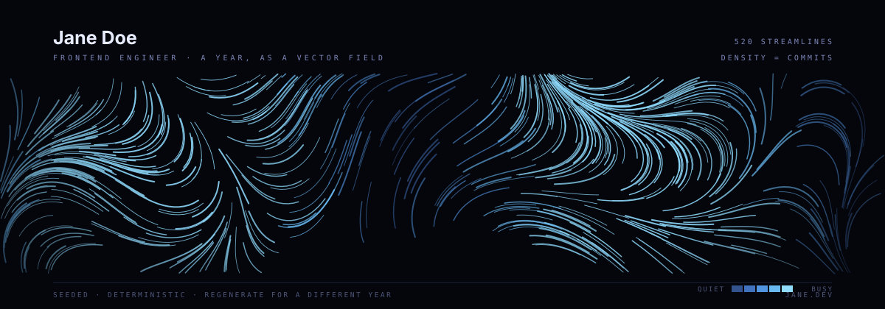

# notharib

  

### the year

{{year_paragraph}}

### what came out of it

- **{{project_one_name}}** — {{project_one_desc}}
- **{{project_two_name}}** — {{project_two_desc}}
- **{{project_three_name}}** — {{project_three_desc}}

— [{{website}}]({{website_url}}) · [@{{twitter}}](https://twitter.com/{{twitter}})

<!--
**Notharib/notharib** is a ✨ _special_ ✨ repository because its `README.md` (this file) appears on your GitHub profile.

Here are some ideas to get you started:

- 🔭 I’m currently working on ...
- 🌱 I’m currently learning ...
- 👯 I’m looking to collaborate on ...
- 🤔 I’m looking for help with ...
- 💬 Ask me about ...
- 📫 How to reach me: ...
- 😄 Pronouns: ...
- ⚡ Fun fact: ...
-->
